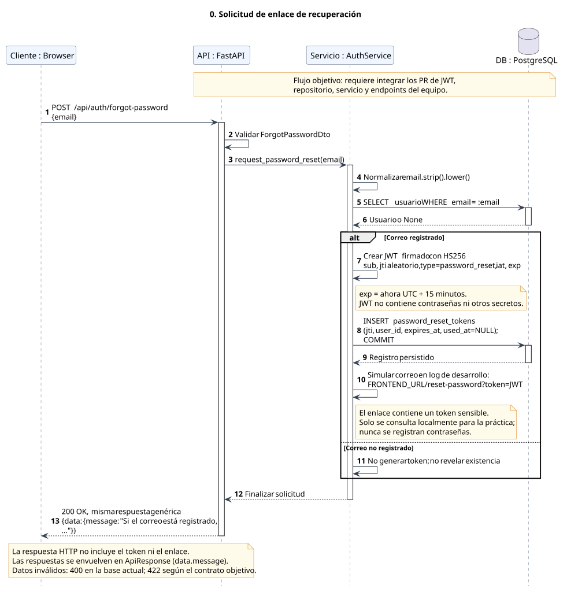
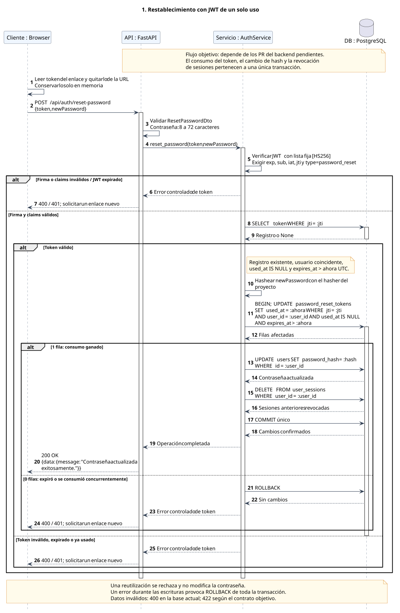

# Diagramas de secuencia UML

Los diagramas describen el **flujo objetivo** de recuperación. No certifican que los endpoints estén implementados: su ejecución depende de integrar primero los cambios del backend del equipo.

| Flujo | Vista | Fuente editable |
| --- | --- | --- |
| 0. Solicitar enlace | [SVG](00-solicitud-recuperacion.svg) | [PlantUML](00-solicitud-recuperacion.puml) |
| 1. Restablecer contraseña | [SVG](01-restablecimiento-contrasena.svg) | [PlantUML](01-restablecimiento-contrasena.puml) |

Se usan líneas de vida `Cliente : Browser`, `API : FastAPI`, `Servicio : AuthService` y `DB : PostgreSQL`; llamadas síncronas con flecha sólida, retornos con flecha punteada, llamadas a sí mismo y fragmentos `alt` con guardas. La ruta HTTP completa conserva el prefijo real `/api` del proyecto.

PlantUML añade los corchetes de las guardas al renderizar `alt` y `else`; por eso los rótulos se escriben sin corchetes adicionales en la fuente.

## 0. Solicitud del enlace



## 1. Restablecimiento y consumo atómico



## Regenerar las vistas

Para regenerar las imágenes, instalar Java y descargar `plantuml.jar` desde el [sitio oficial de PlantUML](https://plantuml.com/download). Desde la raíz del repositorio:

Las vistas incluidas se generaron con PlantUML 1.2026.10, edición `plantuml-java8`, compatible con Java 8. Si se usa el archivo `plantuml.jar` estándar actual, se necesita Java 11 o posterior.

```sh
java -jar /ruta/a/plantuml.jar -charset UTF-8 -tsvg docs/diagrams/*.puml
```

En PowerShell puede ser necesario pasar los archivos explícitamente:

```powershell
java -jar C:\herramientas\plantuml.jar -charset UTF-8 -tsvg docs/diagrams/00-solicitud-recuperacion.puml docs/diagrams/01-restablecimiento-contrasena.puml
```

El renderizado se realiza localmente: no es necesario subir código, enlaces ni tokens a un servidor de diagramas. Referencia de la [línea de comandos oficial](https://plantuml.com/command-line).
